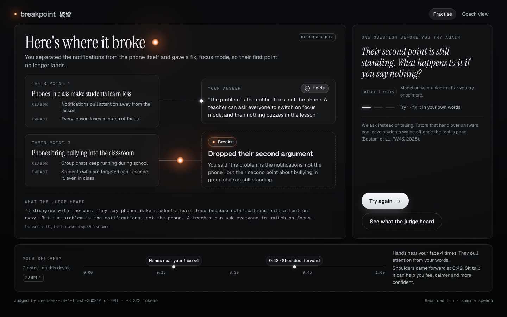

# Breakpoint

**Homework you do out loud.** AI can do written homework in ten seconds, so Breakpoint sets homework a kid says out loud, and it ends with people.

**Say it. Fix it. Take it to a person.** A kid gets tonight's question and says an answer. Breakpoint shows the one weak spot, gives one hint (never the answer), and makes them try again. Then every kid leaves with one question to ask someone at home, and the coach gets a short list of who needs ten minutes. AI finds the gap. People close it.

▶ Demo video (2 min): {VIDEO_URL}



## The problem
Kids learning to debate in English get seconds of feedback each in class, and their practice at home goes unheard. In the founder's own Saturday classes (Taipei, November 2026), the homework was "record a speech, list three fixes", and nobody listens to it; in class each attack and defence gets one quick verdict; and the same breaks repeat every week: dropping the opponent's second argument, switching to a new argument while defending, attacks with no reasoning, and attacking a number without saying why it matters.

## What it does
0. **Homework link.** A coach creates a link and pastes it into LINE, Google Classroom or Canvas. Students open it and type a first name only; no accounts.
1. **Say it.** Pick tonight's question. Breakpoint puts the other side's case as a chain (claim, reason, evidence, impact). Answer it back, or stand your ground on your own point.
2. **Find the break.** Your spoken rebuttal is mapped onto their argument point by point. Each point shows *Holds* or *Breaks*, and the break is named: dropped argument, no link, switched argument while defending, or a number with no "so what". No scores.
3. **Fix it yourself.** One hint, as a question. Then you try again. After a retry, a sentence starter with blanks appears (never the finished answer).
4. **Delivery, on the device.** Posture, swaying and touching your face are tracked in the browser; at most two notes per try. Camera video never leaves the laptop.
5. **Take it to a person.** Every kid leaves with one question to ask someone at home; what they said is saved for the coach. Anything not fixed in two tries, or that the AI was unsure about, goes to the coach's "Who needs ten minutes with me" list.
6. **Coach view.** Who did the homework, what broke first, and whether they fixed it ("Amy · 3 tries · Dropped their second argument → Fixed"); attempts the AI was unsure about say "Check with your coach".

## How it works
- `server.py`: Python standard library only; serves `web/` and the JSON API.
- `engine/`: the judge. One call to a model on GMI Cloud's OpenAI-compatible API maps the rebuttal onto the opponent's points; then plain code checks it: every quote must be the student's own words, a point with no quote counts as not answered, the hint must be one short question, and a first try never gets a model answer. Each report shows which model judged it and how many tokens it used.
- `web/`: plain HTML, CSS and JavaScript; no build step. Speech to text uses Chrome's built-in recognition (en-US). Pose tracking uses MediaPipe Pose Landmarker (lite) running in the browser.

### Run it
```bash
export GMI_API_KEY=...       # your own key from the GMI Cloud console (see .env.example)
python3 server.py            # open http://127.0.0.1:8765 in Chrome
```
Without a key the app replays recorded runs of the sample speeches, labelled "Recorded run". Checks: `python3 engine/selftest.py`, `python3 tests/smoke.py` (server running), `node tests/body/test_metrics.mjs`. Optional: `tools/fetch_vendor.sh` saves the MediaPipe files into `web/vendor/` so body tracking works offline; otherwise they load from the CDN.

## Why it's built this way
- **Hints, not answers.** Students who practised with plain GPT-4 scored 17% lower on the exam without it; a tutor that only gave hints avoided most of that harm (Bastani et al., *PNAS*, 2025; the 17% figure is from the 2024 working paper).
- **Compare tries, don't score.** Language models rank debate speeches about as consistently as human judges agree with each other, but score them lower (Sternlicht et al., EMNLP 2025). So Breakpoint shows *Holds/Breaks* and try 2 against try 1.
- **Delivery advice that holds up.** Sitting tall can help speakers feel calmer and more confident (Nair et al., *Health Psychology*, 2015); gestures help listeners follow (Hostetter 2011; Dargue et al. 2019); distracting movements sit in the low band of the Public Speaking Competence Rubric (Schreiber et al., 2012). We describe movements, never the child.

## Honest limits (tonight)
- The judge is checked on five test speeches (four written samples and the founder's own practice rebuttal); it has not been measured on children's speech.
- Body-tracking thresholds are first guesses, tuned on one adult.
- The class panel in the coach view is SAMPLE data; homework rows are real attempts made through a link.

## Privacy
A first name, the transcript, body notes and take-home answers are stored on the coach's machine in `data/` (not in git). No accounts for kids; a homework link asks for a first name only. Camera video is processed in the browser and never uploaded. Voice is not: Chrome's speech recognition sends audio to Google's speech service, and the transcript is sent to GMI Cloud for the argument check.

## Built at
c0mpiled-18, YC Startup School Hackathon, Taipei, 2026-11-11. Planning notes, research and the design kit (colour tokens and on-screen copy) were prepared before the build session; all code was written during it.

YC Request for Startups: **The Primer** (Fall 2026), for reasoning.

Made by Kun, debate coach, Taipei.
